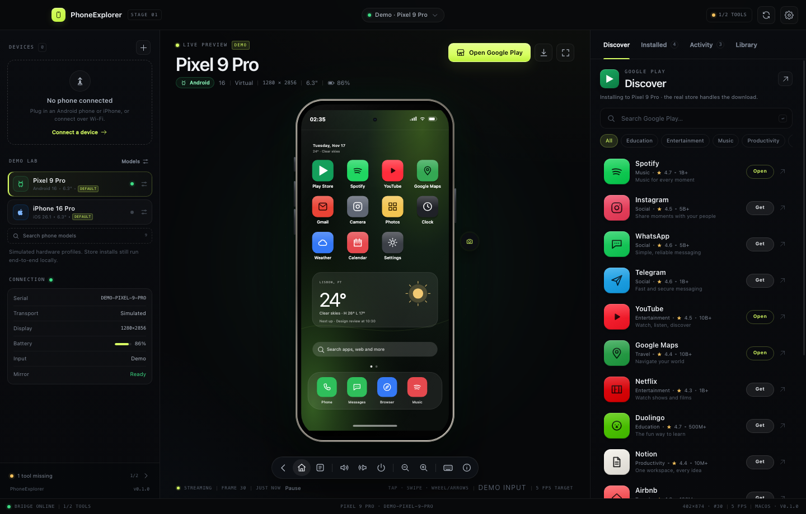
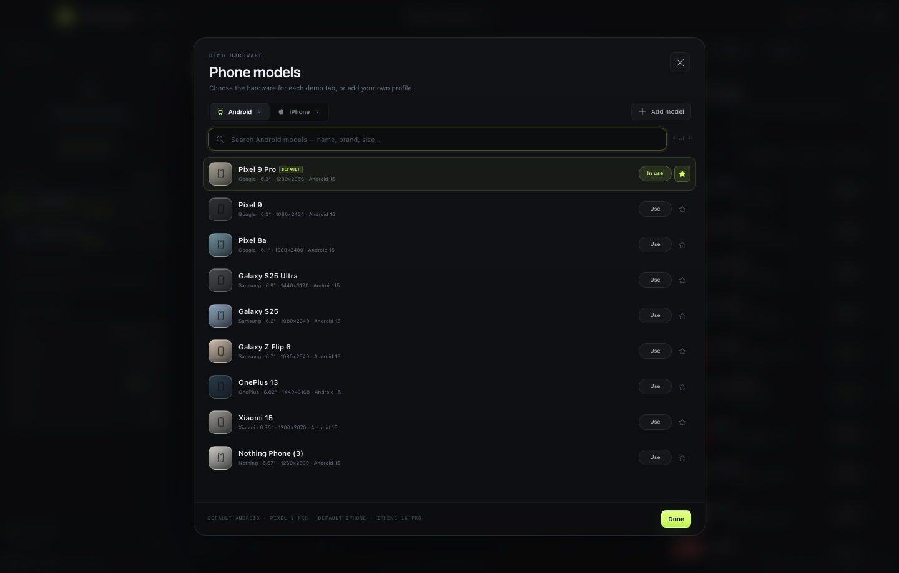
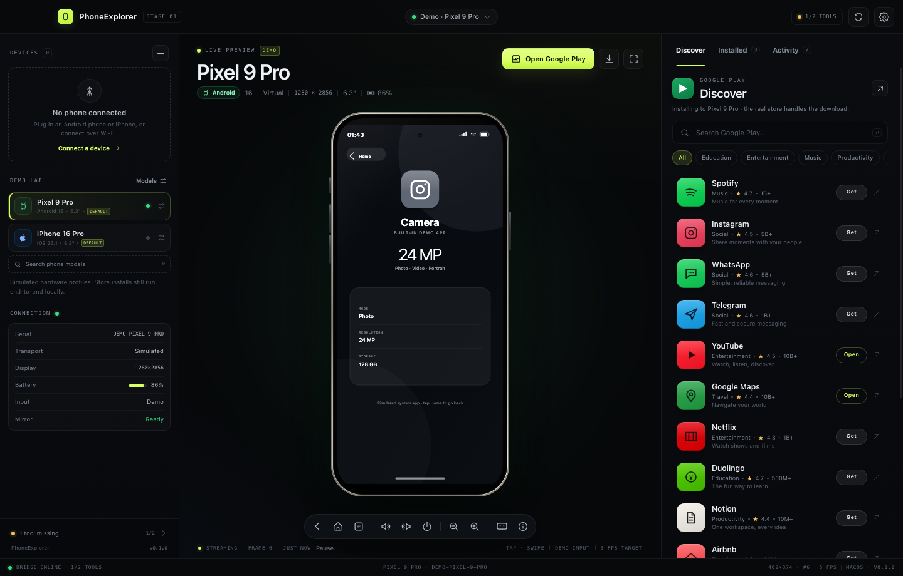
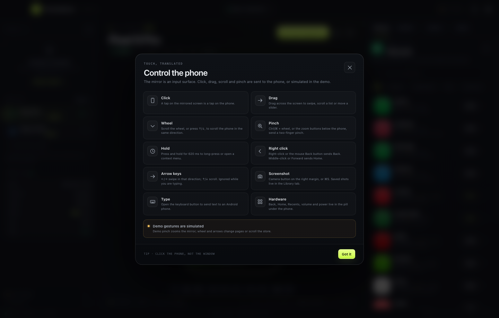
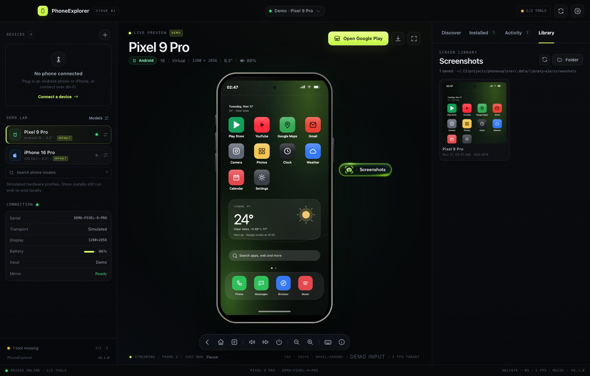
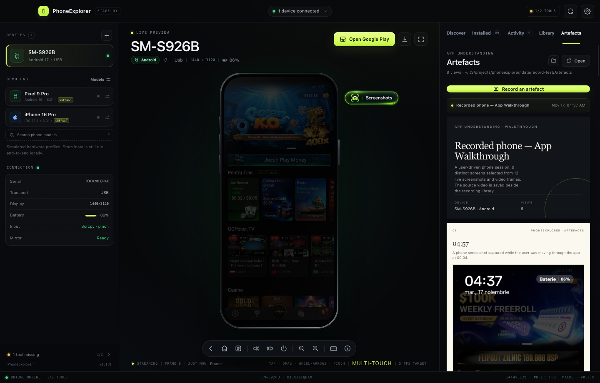

# PhoneExplorer

[](https://github.com/DansiDanutz/PhoneExplorer/actions/workflows/ci.yml)

**Stage 01 — a desktop bridge for your phone.**

PhoneExplorer puts an Android phone or iPhone on your desktop: a near-live screen, real
touch control, the real Google Play / App Store listing, one place to install, and one
click to launch. It is built with Electron, TypeScript and React, and it talks to phones
through the open-source tools the platform already has — `adb`, `libimobiledevice`,
`idb`, and a vendored scrcpy control server.



> **The store stays on the phone.** PhoneExplorer deep-links the real listing and watches
> the device's package list. It never asks for an Apple ID or Google password, never
> scrapes a store, and never installs an App Store app behind your back.

---

## Why

Installing and previewing a mobile app usually means picking the phone up, unlocking it,
finding the store, tapping through, then putting it down again. That loop is small but
constant. PhoneExplorer keeps it on the desktop:

1. **Connect** an Android phone over USB/Wi-Fi, or an iPhone over USB.
2. **Mirror** the screen next to your editor.
3. **Open** the real Play Store / App Store listing from the Discover panel.
4. **Install** on the phone (the store owns the download).
5. **Launch** it from PhoneExplorer and look at it in the mirror.

Stage 01 is deliberately honest about what it automates. Android is fully wired. iPhone
support is real but depends on the open-source iOS bridge; installing from the App Store
is always a user action. No phone? A complete interactive demo phone runs locally.

---

## What works

| Capability | Android | iPhone |
| --- | --- | --- |
| Device discovery | `adb devices`, USB + Wi-Fi | `libimobiledevice` or `idb` |
| Screen preview | `adb exec-out screencap` at 1–10 fps | `idb screenshot` or `idevicescreenshot` |
| Touch control | tap, drag, wheel/arrow scroll, long-press, pinch, Back/Home keys | tap, drag, wheel/arrow scroll, Back/Home edge swipes |
| Screenshots | camera button on the phone margin / ⌘S, Library tab | same |
| App understanding | one-click walkthrough of every workspace tab and overlay, saved as a Pages-style Artefacts document | same |
| Multi-touch | scrcpy control channel (auto, Android 5+) | single touch via idb |
| Store deep link | `market://details`, `market://search` | `itms-apps://` via `idb open-url` |
| Install detection | watches `pm list packages` | watches `idb list-apps` |
| Launch app | `monkey` / `am start` | `idb launch` or `devicectl` |
| Sideload | `adb install -r` (`.apk`) | `ideviceinstaller` / `devicectl` (signed `.ipa`) |
| Demo phone | fully simulated Pixel | fully simulated iPhone |

**Near-live, not video (yet).** Stage 01 captures screenshots at a configurable rate
instead of decoding a video stream. It is enough to judge layouts, navigate the store and
see an app open. A scrcpy video/WebCodecs pipeline is the first item on the roadmap.

### The demo lab

Both demo devices are interactive end to end. Tapping **Get** inside the simulated store
runs a real install animation, adds the icon to the home screen, flips the button to
**Open**, and launches a scene built for that app. This makes the app usable immediately
and gives the automated tests a hardware-free target.

The two demo tabs are hardware profiles, not hard-coded names. Search 18 built-in
Pixel/Galaxy/OnePlus/Xiaomi/Nothing and iPhone profiles, add a custom phone with its own
resolution and frame colour, and choose a default Android and a default iPhone. The
selection is persisted and used whenever the demo lab starts.

Every visible home tile, dock icon and the search bar is a hit target. Camera, Photos,
Clock, Weather, Calendar, Settings, Phone, Messages, Browser and Music open a built-in
demo screen with a Back button instead of being dead artwork.

| Phone models | Built-in app |
| --- | --- |
|  |  |

| | |
| --- | --- |
|  |  |
|  |  |

---

## Quick start

Requirements: **Node 20+**, **macOS 13+** (primary target), or Windows/Linux for the
Android path. A phone is optional.

```bash
git clone https://github.com/DansiDanutz/PhoneExplorer.git
cd PhoneExplorer
npm install
npm run dev
```

The app opens with the **demo lab** selected if no phone is attached.

### Android

1. On the phone, open **Settings → About phone** and tap **Build number** seven times.
2. Open **Developer options** and enable **USB debugging**.
3. Plug in the phone and tap **Allow** on the debugging prompt.
4. Install the platform tools if needed:

   ```bash
   brew install android-platform-tools
   ```

5. Press **Scan again** (or ⌘R). The phone appears under **Devices**.

For wireless debugging, Android 11+ shows an `IP:port` in **Developer options → Wireless
debugging**. Pair once on the phone, then enter the address in **Connect a phone**. For
older devices, `adb tcpip 5555` on a USB connection works.

### iPhone

The iPhone bridge is [libimobiledevice](https://libimobiledevice.org) plus
[`idb`](https://github.com/facebook/idb) for touch, launch and store links:

```bash
brew install libimobiledevice
brew tap facebook/fb
brew install idb-companion
pipx install fb-idb
```

Plug in the iPhone, unlock it, and tap **Trust This Computer**. Then press **Scan again**.

- `libimobiledevice` is enough for discovery, screenshots and install detection.
- `idb` adds touch input, launch, and `itms-apps://` deep links.
- Xcode 15+ also provides `devicectl`, which PhoneExplorer uses for launch/install when
  idb is absent.
- If no bridge is available, the store panel falls back to a **QR code** you can scan with
  the phone camera.

App Store installs cannot be automated: the App Store's download confirmation is a user
action. PhoneExplorer opens the listing and detects the install when it lands.

---

## Using it

- **Discover** searches the curated catalog and deep-links the real store. Press **↵** to
  send the query to the phone's store.
- **Get** opens the listing on the phone (demo: installs locally). When the package
  appears, the button flips to **Open**.
- **Installed** lists apps read from the device, including system apps matched to the
  catalog. Click any icon to launch it.
- **Activity** is a timestamped log of every bridge command, launch and install event.
- **Click the mirror** to tap; **drag** to swipe. **Wheel** or **↑/↓** scrolls, **←/→**
  swipes, **hold** long-presses, **right-click** is Back and **middle-click** is Home.
  Mouse Back/Forward buttons also send Back/Home. If scrolling feels backwards, turn on
  **Reverse scroll** in Settings.
- **GGPoker / PlayGG** is in the catalog as an 18+ app. Its Get button opens the official
  Google Play listing `com.nsus.poker.prodggpcom` or App Store ID `1504833971`. The poker
  table visible in demo mode is a simulated preview, not the real app.
- **App understanding** opens **Artefacts** (⌘5). **Record an artefact** starts a native
  Android `screenrecord` session and also captures a full-resolution phone screenshot every two
  seconds. Move through the phone yourself — PhoneExplorer never taps the app. When you stop,
  ffmpeg extracts scene/key frames, Tesseract labels the distinct screens, and the result is
  saved as phone screenshots in **Library** plus a Pages-style document in Artefacts. A **Stop
  recording** control is always available. The source MP4 is kept under
  `~/Pictures/PhoneExplorer/Recordings`. This requires Android `screenrecord`, `ffmpeg`, and
  Tesseract; the previous automatic tap explorer is no longer shipped.
- **Screenshot** with the camera button on the phone’s right margin, or **⌘S**. Every capture
  lands in **Library** (⌘4), where you can preview, reveal and delete it. The Library header
  shows the exact folder; normally `~/Pictures/PhoneExplorer`.
- **Ctrl/⌘ + wheel** or the zoom buttons send a two-finger **pinch** on Android through the
  scrcpy control channel. On Android, tap, drag, scroll, long-press, Back and Home always
  use adb, so basic control does not depend on scrcpy starting.
- The pill below the phone has Back, Home, Recents, volume, power, pinch zoom, keyboard
  input and a gesture guide.
- **Focus mode** hides both rails; **Esc** returns.







[Open the Artefacts page reader](docs/screenshots/artefact-page.png)

Other screens: [app detail](docs/screenshots/app-detail.png) ·
[installed apps](docs/screenshots/installed.png) ·
[connection setup](docs/screenshots/connect.png) ·
[settings](docs/screenshots/settings.png) ·
[app sheet](docs/screenshots/app-sheet.png) ·
[QR handoff](docs/screenshots/qr.png) ·
[focus mode](docs/screenshots/focus.png).

---

## How it works

```
┌──────────────────────────── Electron main ────────────────────────────┐
│ DeviceManager                                                        │
│  ├─ AdbClient          → adb: devices, getprop, screencap, input, …   │
│  ├─ IosBridge          → idb / libimobiledevice / devicectl           │
│  ├─ DemoDevice ×2      → deterministic SVG phone screens              │
│  ├─ install watcher    → pm list packages / idb list-apps             │
│  └─ preview engine     → PNG → nativeImage → JPEG → IPC               │
└───────────────────────────────┬───────────────────────────────────────┘
                                │ contextBridge + typed IPC
┌───────────────────────────────▼───────────────────────────────────────┐
│ React renderer                                                       │
│  Device rail · phone stage · Discover / Installed / Activity         │
└───────────────────────────────────────────────────────────────────────┘
```

The phone is always the source of truth. The desktop is an orchestrator: it asks for a
screenshot, sends an input event, opens a URL, and reads the package list. It does not
proxy the store or hold credentials.

More detail: [docs/ARCHITECTURE.md](docs/ARCHITECTURE.md).
Open-source survey and design rationale: [docs/RESEARCH.md](docs/RESEARCH.md).

### Security posture

- `contextIsolation: true`, `sandbox: true`, `nodeIntegration: false`.
- A single typed preload bridge; no Node APIs in the renderer.
- CSP allows local scripts, data images and the dev server only.
- External navigation is denied and handed to the system browser.
- No telemetry, no accounts, no network services of our own. Everything is local.
- The only outbound requests are the store pages you explicitly open (and the optional
  links in Settings).

---

## Development

```bash
npm run dev         # electron-vite dev server + Electron
npm run build       # build main, preload and renderer
npm run typecheck   # strict TS across all three targets
npm test            # unit + scene rendering tests
npm run e2e          # Playwright: demo install → open → iPhone → settings
npm run e2e:models   # model search, custom profile, defaults, delete
npm run e2e:gestures # guide, right-click Back, scroll/pinch fallbacks
npm run e2e:library  # screenshot button, Library preview, delete, native-resolution PNG
npm run e2e:phone-artefacts # device-only recording test (real Android, ffmpeg, Tesseract)
npm run e2e:real     # Playwright + a fake adb: discovery, mirror, install, gestures, launch
npm run showcase     # regenerate docs/showcase screenshots
npm run icon        # rebuild build/icon.png + icon.icns
npm run dist        # electron-builder: dmg + zip (macOS)
```

### Testing strategy

- **Unit / scene tests** render every demo screen (home, store, detail and all 15 app
  scenes on both platforms) and assert well-formed output. The SVG files are also checked
  with `xmllint` in development.
- **Demo E2E** drives the real renderer with Playwright: connect, store, install, open,
  iPhone switch, app sheet, QR, focus mode, settings and connect sheet.
- **Model E2E** searches the catalog, switches hardware, creates a custom model, sets both
  platform defaults, verifies persistence and deletes the custom profile.
- **Gesture E2E** checks the guide, right-click Back, wheel-scroll, pinch fallback and
  long-press on the demo.
- **Library E2E** captures a phone-margin screenshot, checks the native 402×874 PNG, opens
  it in the Library viewer and deletes it from disk and the panel.
- **Phone Artefacts E2E** is device-only: it starts a recording, moves the phone through a
  short sequence, stops, and verifies that phone screenshots land in Library and the Pages
  document is generated. It requires Android `screenrecord`, ffmpeg and Tesseract. CI skips it
  because no phone is attached.
- **Real-path E2E** points the app at `scripts/fake-adb.mjs`, a tiny adb stand-in that
  implements device discovery, screenshots, package lists, input and store deep links.
  It proves the Android pipeline without hardware: frame capture, install detection via
  `pm list packages`, `monkey` launch, `market://` links, wheel scroll, long-press,
  right/middle-click Back/Home, and the multi-touch-unavailable fallback.

> The E2E scripts launch Electron with `--no-sandbox` because they run inside a CI/agent
> sandbox. The shipped app keeps Chromium's sandbox on.

### Project layout

```
src/
  main/
    index.ts                 Electron lifecycle, window, IPC, screenshot harness
    services/
      manager.ts             state, device orchestration, preview + install watchers
      adb.ts                 adb wrapper + parsers
      ios.ts                 idb / libimobiledevice / devicectl bridge
      scrcpy-control.ts      control-only scrcpy session (multi-touch, pinch, scroll)
      demo.ts                interactive simulated phones (SVG scene engine)
  preload/index.ts           contextBridge API
  renderer/                  React UI (no UI framework, hand-built design system)
    components/Library.tsx   screenshot gallery, preview, reveal and delete
    components/Artefacts.tsx Pages-style walkthrough document
  shared/                    types, app catalog, phone models, store links, marks
vendor/
  scrcpy-server              unmodified scrcpy 3.3.3 control server (Apache-2.0)
scripts/
  e2e.mjs · e2e-real.mjs · e2e-models.mjs · e2e-gestures.mjs · e2e-library.mjs
  fake-adb.mjs · showcase.mjs · contact-sheet.mjs · make-icon.mjs · fixture-screen.mjs
docs/                        architecture, research, screenshots
```

---

## Limitations (Stage 01)

- **Preview is screenshot polling**, capped at 10 fps. Input is independent of the frame
  rate, but visual feedback has a few hundred milliseconds of lag. Stage 02 will decode
  scrcpy's H.264 stream with WebCodecs for 30–60 fps video. The scrcpy control channel is
  already wired for multi-touch.
- **Pinch is Android-only.** It needs the scrcpy control channel; the iPhone bridge injects
  single touch, and WebDriverAgent-based pinch is future work.
- **Demo gestures are simulated.** Swipe/wheel turn home pages or scroll the store; pinch
  zooms the mirrored demo. App-level pinch needs a real Android phone.
- **The scrcpy pinch path is not hardware-tested here.** It is implemented against
  scrcpy 3.3.3; single-touch input does not depend on it and always uses adb.
- **Phone models are demo profiles.** They set name, OS, resolution and frame colour for
  the simulated device; they do not emulate a different OS or app runtime.
- **No audio.** scrcpy audio forwarding is also a Stage 02 goal.
- **iPhone live capture** uses the same screenshot loop. A native CoreMediaIO/AVFoundation
  helper (the path QuickTime uses) is the next step; macOS 15's iPhone Mirroring has no
  public embedding API.
- **App Store installs are user-driven.** Deep-linking works; silent installs do not, by
  platform design. The QR fallback covers phones where idb cannot open URLs.
- **Notion, Slack and store metadata** in the catalog are illustrative. IDs can change;
  the real listing is always the phone's.
- The Android pipeline is covered by the fake-adb E2E but has not been run against a
  physical phone in this environment. The iPhone bridge was likewise validated against
  its command contract, not hardware. See [docs/RESEARCH.md](docs/RESEARCH.md) for the
  support matrix and how to contribute real-device logs.
- Windows/Linux packaging is configured but macOS is the tested target.

---

## Open-source ideas we started from

PhoneExplorer would not exist without these projects. The full survey — what we borrowed,
what we deliberately did not, and licenses — is in [docs/RESEARCH.md](docs/RESEARCH.md).

- [scrcpy](https://github.com/Genymobile/scrcpy) — the reference Android mirroring tool.
- [Escrcpy](https://github.com/viarotel-org/escrcpy) — an Electron GUI over scrcpy; the
  clearest prior art for this product shape.
- [QtScrcpy](https://github.com/barry-ran/QtScrcpy) — cross-platform GUI and key-mapping.
- [@yume-chan/scrcpy](https://github.com/yume-chan/scrcpy) — TypeScript scrcpy protocol.
  Stage 01 uses its control channel; the WebCodecs video path is planned for Stage 02.
  The vendored `scrcpy-server` is unmodified scrcpy 3.3.3 (Apache-2.0).
- [libimobiledevice](https://libimobiledevice.org) and [idb](https://github.com/facebook/idb)
  — the iPhone bridge.
- [electron-vite](https://electron-vite.org) and
  [electron-builder](https://www.electron.build) — build and packaging.
- [Playwright](https://playwright.dev) — renderer and Electron E2E.

App icons in the UI and demo are original geometric monograms, not third-party artwork.

---

## License

MIT © 2026 DansiDanutz. See [LICENSE](LICENSE).
